<h1 align="center">
  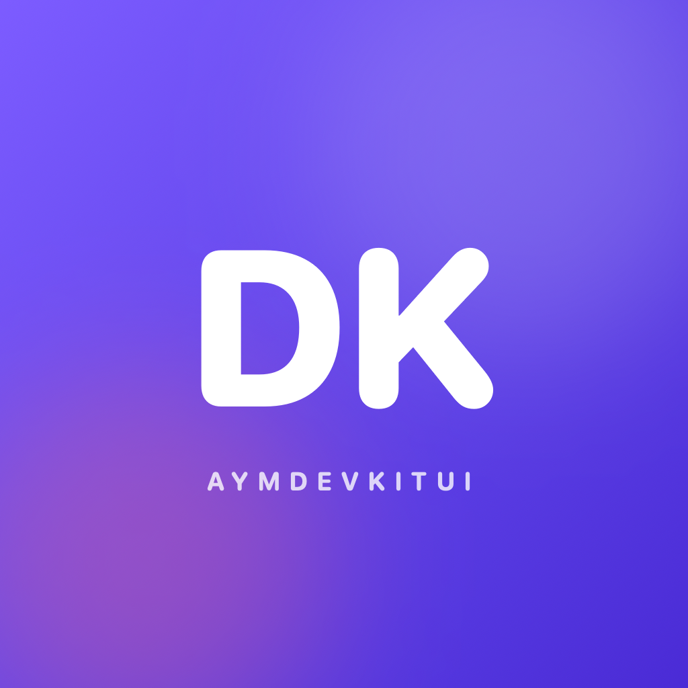
  <br>
  AYMDevKitUI
</h1>

<h3 align="center">Andy Yu 的 macOS UI 开发工具库</h3>

<p align="center">
  <a href="./README.md">English</a> ·
  <a href="./README.zh-CN.md">简体中文</a>
</p>

<p align="center">
  
  
  
  
</p>

AYMDevKitUI（简称 **AYMDKUI**）是一套面向原生 macOS 应用的 SwiftUI 设计系统与应用框架。它把一套由品牌色推导的视觉语言、每个应用都需要的两个面板，以及让它们保持一致的交互规则，收进一组很小的 API 里。

使用它的应用共享同一套色彩语言、同一套字号、同一套动效词汇、同一个 ASCII 环境背景、同一个欢迎流程和同一个设置面板。变化的只有应用身份。

## 预览

| 浅色 | 深色 |
| --- | --- |
| 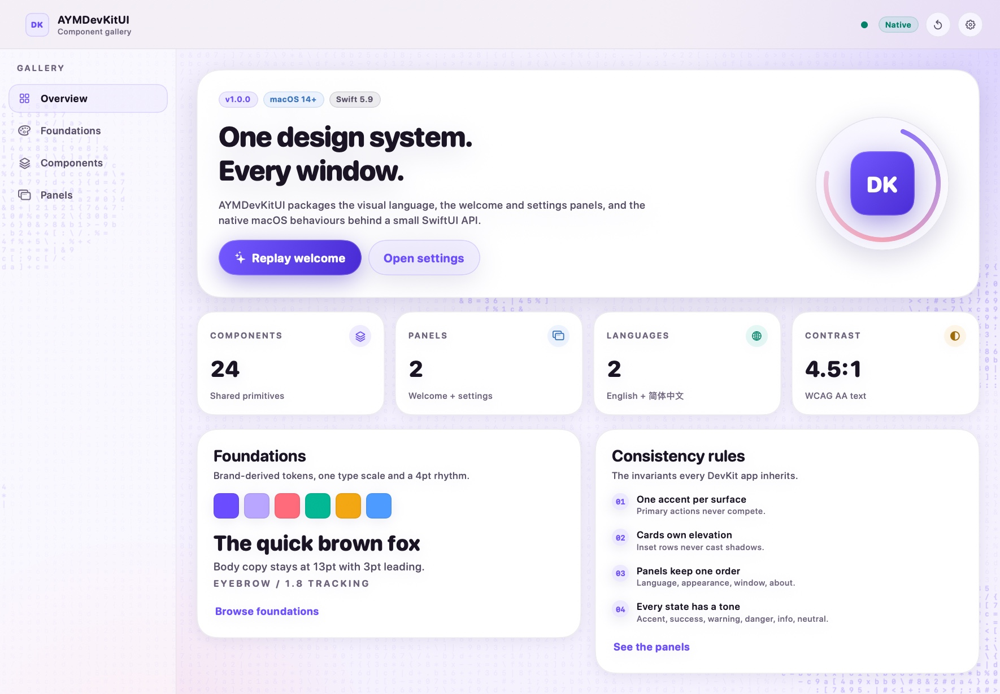 | 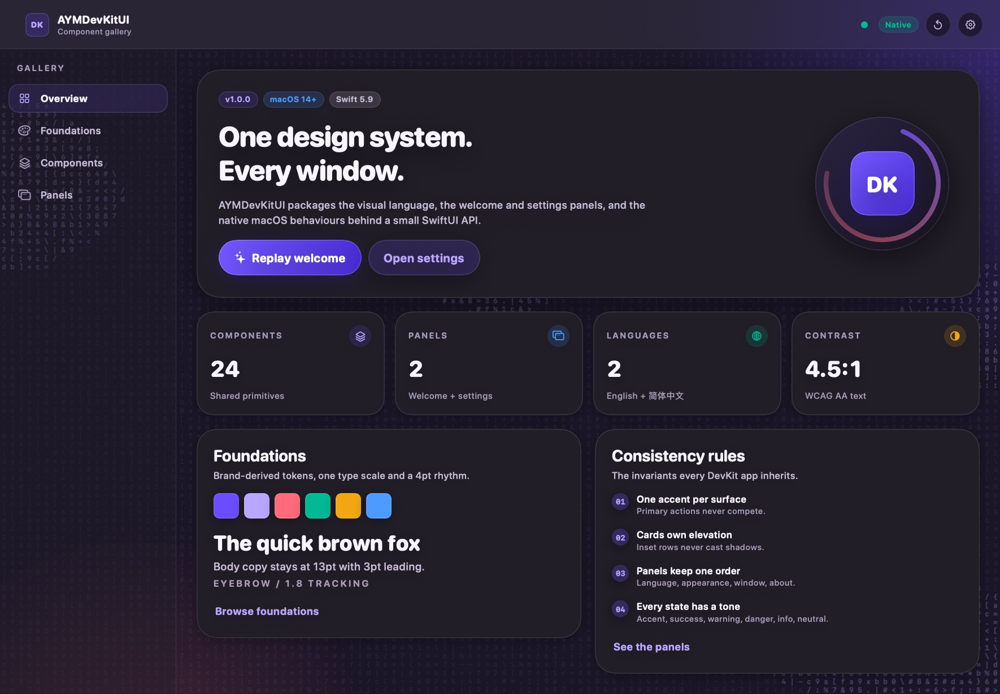 |

## 窗口外观

原生交通灯直接浮在应用画布上：没有标题、没有不透明标题栏、没有系统灰色横条。品牌渐变与 ASCII 字符场一直延伸到窗口顶边；切换深浅色时，包括标题栏在内的整个窗口一起交叉淡化。

| 浅色 | 深色 |
| --- | --- |
| 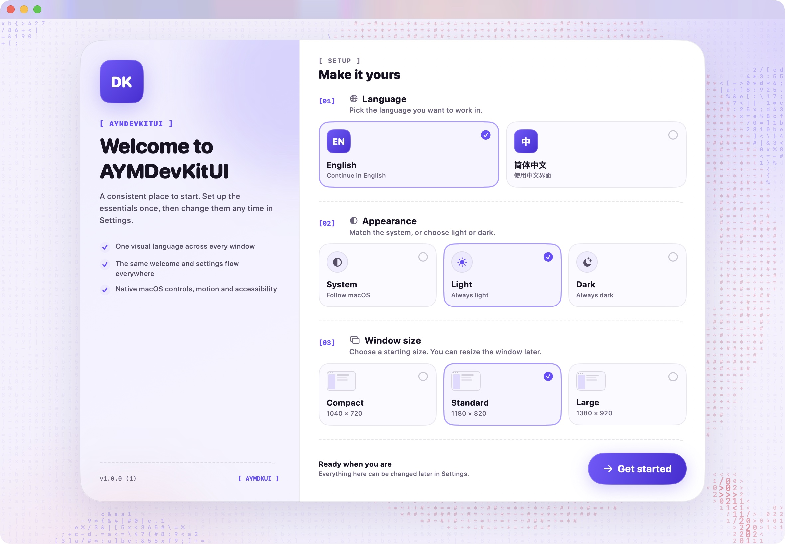 | 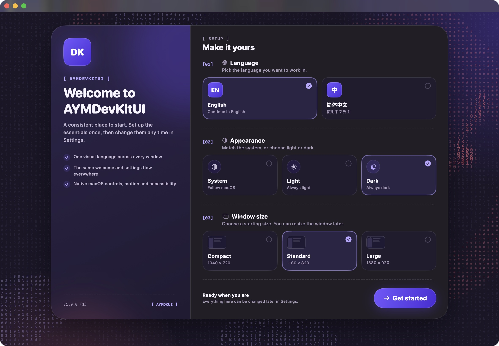 |

## 保持不变的部分

- **一套色彩语言。** `DKBrand` 只有六个颜色，`DKTheme` 为浅色和深色推导出所有表面、描边、可读强调色与渐变。
- **默认跟随系统。** 浅色、深色与跟随系统三选一，默认跟随系统；选择会被持久化。
- **一套动效词汇。** 快速反馈、标准布局弹簧、强调状态变化，以及双向都由库提供的深浅色交叉淡化——内容与标题栏一起淡入淡出。
- **一套交互层级。** 环境背景 → 表面 → 控件 → 反馈 → 面板。悬停、按下、选中与禁用状态全部共用。
- **两个固定框架面板。** 欢迎面板按固定顺序收集语言、外观和窗口尺寸；设置面板镜像同样的选项，并允许宿主追加自己的分组。
- **ASCII 环境。** 所有背景都是密集的动态代码场：双层行波、柏林噪声深度、点击环和指针尾迹。
- **无缝窗口外观。** 原生交通灯直接浮在应用画布上：全尺寸内容、透明标题栏、隐藏标题，没有灰色系统条，也没有标题文字。尺寸预设原地缩放，不再重新居中或跳到旧位置。

## 欢迎面板

首次启动的欢迎面板是一道入口，不是教程：一张卡片、三个步骤、一个主操作。顺序永远是 **语言 → 外观 → 窗口尺寸**。

| English | 简体中文 |
| --- | --- |
| 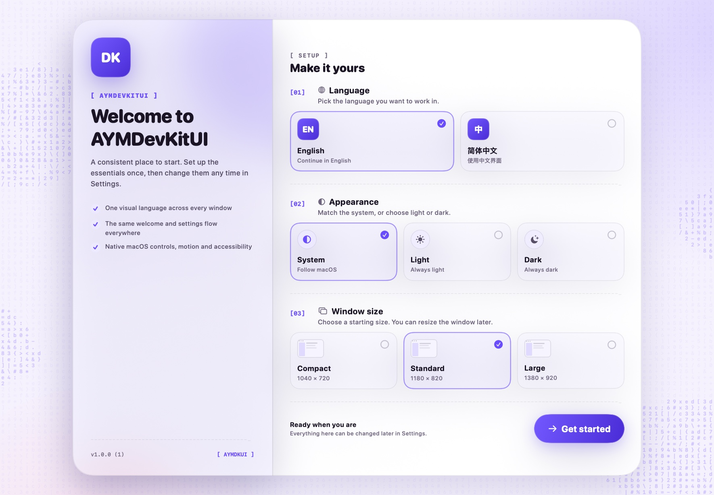 | 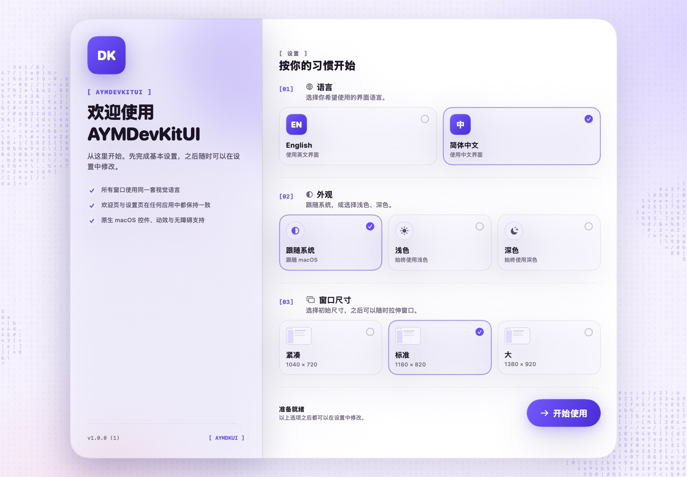 |

深色外观下的同一面板：

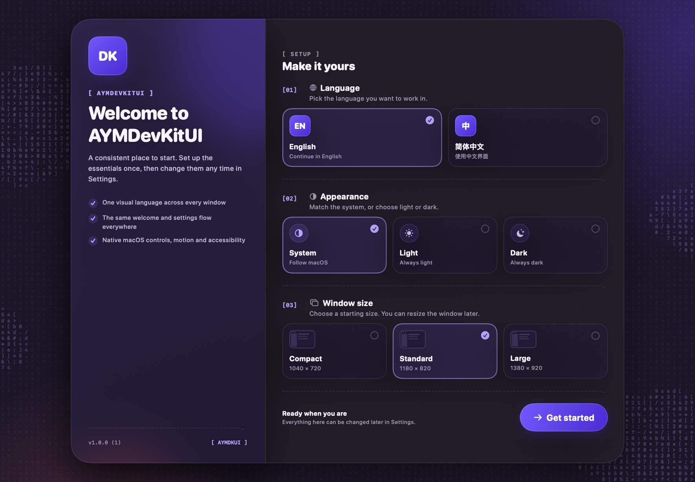

所有文案都提供英文与简体中文。宿主可以覆盖 eyebrow、标题、副标题、要点、脚注和主按钮文字，而不需要替换面板本身。

## 设置面板

设置面板与欢迎面板共用 `[01] … [03]` 的编号节奏、同一套选项卡片和同一套标签。宿主通过 `DKSettingsSection` 追加分组，但不能重排核心区块。

<p align="center">
  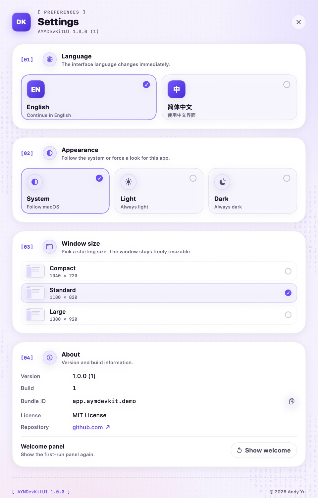
</p>

- `[01] 界面语言` — English / 简体中文。
- `[02] 外观` — 跟随系统 / 浅色 / 深色，切换时由库执行交叉淡化。
- `[03] 窗口尺寸` — 紧凑 1040 × 720、标准 1180 × 820、大 1380 × 920。
- `[04] 关于` — 版本、构建号、Bundle ID、许可证、链接，以及“重新显示欢迎面板”。

`⌘,` 打开标准的 Settings 场景。`DKSettingsPanel` 为 640 × 680 窗口设计，宿主追加分组后自动滚动。

## 组件

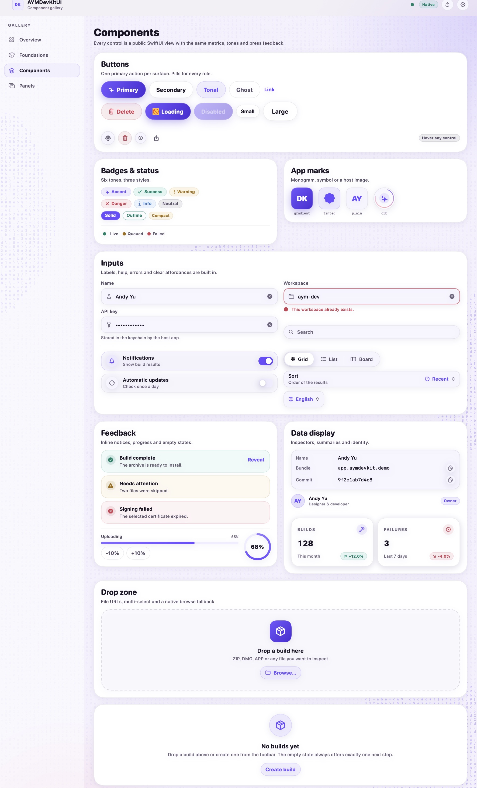

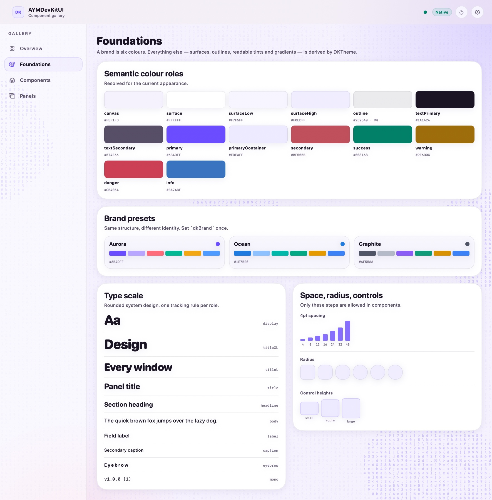

完整目录见 [`docs/components.md`](./docs/components.md)，简表如下：

| 层 | 类型 |
| --- | --- |
| 基础 | `DKBrand`、`DKTheme`、`DKColor`、`DKTone`、`DKText`、`DKTextStyle`、`DKSpacing`、`DKRadius`、`DKControlSize`、`DKMotion` |
| 表面 | `DKCard`、`DKInset`、`DKHairline`、`DKASCIIRule`、`DKAppBackground`、`DKASCIIField`、`DKOrb` |
| 控件 | `DKButton`、`DKIconButton`、`DKChoiceCard`、`DKSegmentedControl`、`DKMenuPicker`、`DKTextField`、`DKSearchField`、`DKToggleRow` |
| 反馈 | `DKBadge`、`DKNotice`、`DKProgressBar`、`DKProgressRing`、`DKEmptyState`、`DKSpinner`、`DKStatusDot`、`DKLiveDot` |
| 数据 | `DKInfoRow`、`DKStatTile`、`DKAvatar` |
| 导航 | `DKSidebar`、`DKTopBar`、`DKAppShell`、`DKDragArea` |
| 文件 | `DKDropZone` |
| 面板 | `DKWelcomePanel`、`DKSettingsPanel` |
| 框架 | `DKAppRoot`、`DKAppSettings`、`DKAppInfo`、`DKAppCommands`、`DKWindowManager`、`DKAppearanceTransition`、`DKAmbient` |

## ASCII 环境

`DKAppBackground` 不再使用纯色或点阵，而是绘制等宽字符场：

- 10 × 10pt 的等宽代码字符网格，字号 8.5pt。基线按扫描行整行绘制，因此在保持高密度的同时不必逐字布局上千次。
- **字符本身在动。** 每个单元格按错开的 1.35 秒节拍重新掷出字符，背景永远不会静止；基线的颜色始终是品牌主色。
- 水面由两组交叉行波构成；深度来自三层确定性二维柏林噪声（`DKNoise`）。波峰只提亮，不改变颜色。
- **鼠标悬停是字符场里的尾迹，而不是独立覆盖层。** 指针采样点被栅格化到同一套网格中；邻近单元格切换到尾迹字符集与强调色，尺寸从尾部的 8.5pt 衰减到指针附近的 13.5pt。
- **点击是另一种交互。** 点击（`DKAppRoot` 已自动应用 `.dkAmbientRipples()`）会产生扩散环，使用独立的涟漪字符集与强调色，持续 2.4 秒。
- 空闲 6 fps、移动或起涟漪时 12 fps，使用 `Canvas`；窗口失焦或开启“减弱动态效果”时暂停。`DKAppRoot(backgroundFieldIntensity:)` 可调低或关闭。

## 环境要求

- macOS 14 或更高版本。
- Swift 5.9 或更高版本。
- Xcode 15 或更高版本（SwiftUI 宏需要完整 Xcode 工具链，仅有 Command Line Tools 不够）。

## 安装

在 `Package.swift` 中加入依赖：

```swift
dependencies: [
    .package(url: "https://github.com/Dirty-Octopus/AYMDevKitUI.git", from: "1.0.0")
]
```

在首个 tag 发布前，请使用 `branch: "main"`。

然后把两个产品之一加入 target：

```swift
.product(name: "AYMDevKitUI", package: "AYMDevKitUI")
// 或者短别名：
.product(name: "AYMDKUI", package: "AYMDevKitUI")
```

```swift
import AYMDevKitUI
// 或：import AYMDKUI
```

两个产品暴露同一套公开 API；`AYMDKUI` 只是重新导出规范模块。

## 快速开始

```swift
import SwiftUI
import AYMDevKitUI

@main
struct MyApp: App {
    private let info = DKAppInfo(
        name: "MyApp",
        tagline: "一个小型原生工具",
        version: "1.0.0",
        bundleIdentifier: "app.myapp",
        mark: .monogram("MA")
    )

    @StateObject private var settings = DKAppSettings(welcomeVersion: "1")

    var body: some Scene {
        WindowGroup {
            DKAppRoot(info: info, brand: .aurora, settings: settings) {
                DKAppShell(info: info) {
                    ContentView()
                }
            }
        }
        .commands {
            DKAppCommands(settings: settings, info: info)
        }

        Settings {
            DKSettingsPanel(info: info, settings: settings)
        }
    }
}
```

`DKAppRoot` 负责背景、欢迎门禁、品牌与语言环境、外观偏好、点击涟漪和窗口挂载；`DKAppShell` 负责顶栏与拖拽区。

### 换一套身份

```swift
DKBrand.ocean      // 冷蓝 / 青绿
DKBrand.graphite   // 安静、近乎单色
```

把 brand 传给 `DKAppRoot` 与 `DKSettingsPanel`（后者是独立场景），所有表面、描边、强调色与渐变都会随之推导。

## 设计与交互契约

- [`docs/design-language.md`](./docs/design-language.md) — 色彩推导、字号、间距、表面、ASCII 场与动效。
- [`docs/interaction-spec.md`](./docs/interaction-spec.md) — 交互层级、悬停/按下/选中、窗口缩放与拖拽、外观过渡、无障碍。
- [`docs/panels.md`](./docs/panels.md) — 欢迎与设置面板的结构、配置、本地化与版本策略。
- [`docs/components.md`](./docs/components.md) — 组件目录与使用规则。

## 本地化

包内提供 `en.lproj` 与 `zh-Hans.lproj`。新增一种语言只需要：

1. 在 `DKLanguage` 中增加一个 case。
2. 新建同名 `.lproj` 目录并补齐同一套 key。
3. 欢迎与设置面板会自动出现该选项。

```swift
public enum DKLanguage: String, CaseIterable, Identifiable, Codable {
    case english = "en"
    case simplifiedChinese = "zh-Hans"
    // 增加 japanese = "ja"，并添加 ja.lproj
}
```

`DKL10n.t(_:)` 用于 AppKit 场景（窗口标题、菜单）；`DKL10n.text(_:)` 通过 SwiftUI 的环境 locale 解析。

## 开发

```bash
# 构建库、别名与示例
swift build

# 运行单元测试
swift test

# 打开组件画廊
swift run AYMDevKitUIDemo

# 重新生成 README 使用的截图
swift run AYMDevKitUIDemo --snapshot docs
```

如果 `swift` 指向 Command Line Tools，请指向 Xcode：

```bash
export DEVELOPER_DIR=/Applications/Xcode.app/Contents/Developer
```

`--snapshot` 使用 `ImageRenderer` 离屏渲染欢迎页、设置页、画廊与基础页。面板在截图中不经过 ScrollView，以便完整捕获内容；实际应用仍正常滚动。

## 仓库结构

```
Sources/
  AYMDevKitUI/
    Core/        品牌、主题、颜色、字号、尺寸、设置、窗口、外观过渡
    Components/  表面、控件、反馈、数据、导航、ASCII 场、拖放
    Panels/      统一的欢迎与设置面板
    Shell/       应用根、外壳、顶栏、菜单、窗口挂载
    Resources/   en + zh-Hans 文案
  AYMDKUI/       重新导出规范模块的短别名
  AYMDevKitUIDemo/
Tests/
  AYMDevKitUITests/
docs/
```

## 参与贡献

欢迎 issue 与 PR。请遵守以下框架契约：

- 新颜色必须来自 `DKBrand` / `DKTheme`，不要在组件里写临时 hex。
- 新控件必须使用 `DKControlSize`、`DKRadius`、`DKMotion` 与共享字号。
- 新面板必须保持 `语言 → 外观 → 窗口` 顺序。
- 新文案必须同时补齐 `en` 与 `zh-Hans`。

## 致谢

- [Seal](https://github.com/Dirty-Octopus/seal) — 原始 macOS 应用，本库的视觉语言与欢迎/设置流程来源于它。
- [Clash Verge Rev](https://github.com/clash-verge-rev/clash-verge-rev) — README 排版参考。
- SwiftUI 与 AppKit。
- Material 3 Expressive 对 Seal 已有表面与动效思路的影响。

AYMDevKitUI 与 Apple 无隶属关系。

## 许可证

MIT，详见 [LICENSE](./LICENSE)。
